
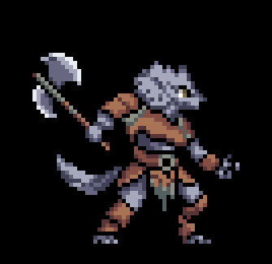


<picture>
  <source media="(prefers-color-scheme: dark)" srcset="images/logo-dark.png">
  <source media="(prefers-color-scheme: light)" srcset="images/logo-light.png">
  
</picture>

 

*Only the forgotten die.*

 

### [Download](../../releases)

 

*First they forget a song.* 
*Then a name.* 
*Then the faces that knew them stop knowing them at all.*

*As long as someone keeps you, you live.* 
*When the last one lets go,* 
*you are gone.*

 

## The Line

Everyone is held by the Line. Nobody can say what it is, and nobody asks. People speak of it the way others speak of fate: it is simply there, holding you to everyone who remembers you.

When it is cut, it does not kill you. It takes you apart. The first thing to go is something small: a tune you used to hum, the way home. Then larger things. Then the world begins to forget *you*: your handwriting fades, your friends look through you, your house feels empty with you inside it. You know it is happening the whole time. And when the very last person who remembers you lets go, you are gone, and no one notices.

## A world that has learned to live with it

In every house and every tavern there is **one chair too many**. Nobody knows whose it is. Nobody sits on it, and nobody takes it away.

On the morning a chair like that appears, the village carries an **empty coffin** to its edge and buries it. Whom for, nobody knows. Nobody cries. It has always been done this way.

Everyone keeps a **book of memories**, and the ink fades the moment nobody remembers the one who wrote it. It has never helped. People keep writing anyway.

And when they part, they do not say goodbye. They say **"Keep me."** The answer is a promise: **"I will."**

Lately, someone has been seen at the edge of the forest. *The one without a face.*

 

## The battle

The field is severed down the middle. Four stand on one side; on the other, whatever has come for them.

You lead one of them, and the others fight beside you, each in their own way. You can step into any of them at any moment. Every blow is announced before it falls: light creeps across the ground and counts down beneath your feet. Read it. Step out on the last breath. Hold your shape together, because a formation held is stronger than any one of you, and break what stands against you.

 

## The four

### Vael
**Master of Timing**

A blaster that runs hot. Hold the trigger and it spins faster, cyan to gold to red. Let go while it glows gold and it **vents** into stronger shots; hold too long and it seizes. Step out of a blow at the very last instant for a **perfect** dodge, and the fire comes faster still. He counts the beats the way other people breathe.

 

### Rhosyn
**Master of Order**

Potions thrown over the enemy line onto whole patterns of the field. Five brews turn on her belt, and each one reacts with the mark the one before it left: acid, fire, frost, shock, blast. In the right order, every throw sets the next one off. Steady hands, a loud laugh, and a notebook she never lets anyone read.

 

### Grask
**Master of Space**

A quiet man who becomes something else in battle. He throws his axe, leaves it buried in the ground and calls it home, and it tears through everything between the two of them on its way back. The throw is half of it. Where he stands when he calls is the other half. He carves little wooden animals when he cannot sleep.

 

### Meridia
**The Returning Flame**

Third of the Five Flames, the youngest master there has ever been. Her fan flies down the row like a boomerang and hits everyone in its path twice, once going and once coming back. Hold the throw and it charges until the fan catches fire. *What strikes you burns back.* She never stands still, and she never stops smiling.

 

 

---

Unpack the zip and start **`TheSeveredLine.exe`**. Keyboard or controller.

Windows may warn about an unknown publisher the first time: choose <b>More info → Run anyway</b>.

 

<i>An early alpha. The line is still being drawn.</i>

