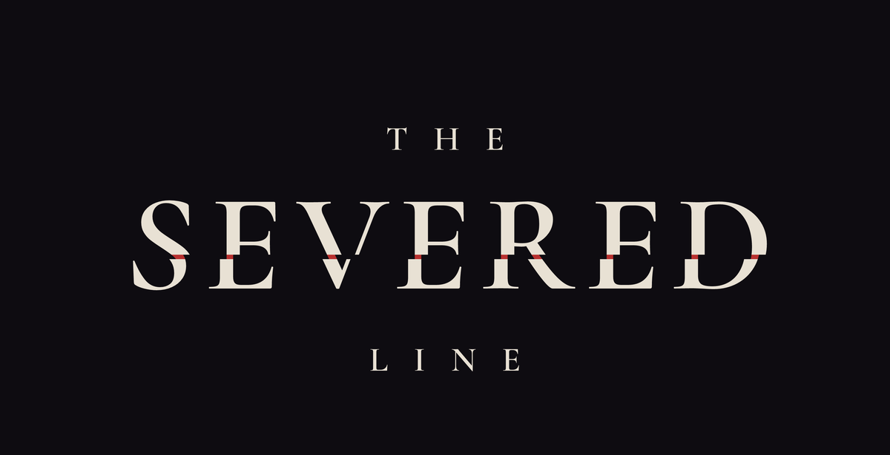
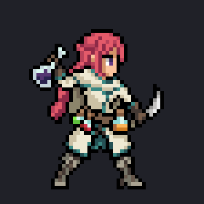

 

*Only the forgotten die.*

 

### [Download](../../releases)

 

*First they forget a song.* 
*Then a name.* 
*Then the faces that knew them stop knowing them at all.*

*As long as someone keeps you, you live.* 
*When the last one lets go,* 
*you are gone.*

 

**Keep me.** — *I will.*

 

---

 

Four of them stand on one side of a severed field. Something waits on the other.

You lead one; the others fight beside you, each in their own way. Every blow is announced before it falls, as light creeping across the ground and counting down beneath your feet. Read it. Step out on the last breath. Hold your shape together, and break what stands against you.

 

<table>
<tr>
<td align="center" width="25%"> <b>Vael</b> Master of Timing</td>
<td align="center" width="25%"> <b>Rhosyn</b> Master of Order</td>
<td align="center" width="25%"> <b>Grask</b> Master of Space</td>
<td align="center" width="25%"> <b>Meridia</b> The Returning Flame</td>
</tr>
<tr>
<td align="center" valign="top"><i>Fire on the beat. Step out on the last breath.</i></td>
<td align="center" valign="top"><i>Five brews, one order, and the world reacts.</i></td>
<td align="center" valign="top"><i>He throws the axe. He calls it home.</i></td>
<td align="center" valign="top"><i>What strikes you burns back.</i></td>
</tr>
</table>

 

---

Unpack the zip and start **`TheSeveredLine.exe`**. Keyboard or controller.

Windows may warn about an unknown publisher the first time: choose <b>More info → Run anyway</b>.

 

<i>An early alpha. The line is still being drawn.</i>

